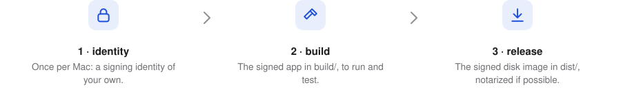

<p align="center">
  
</p>

Turns a Swift package into a real macOS app without an Xcode project: the release binary, Info.plist, translations, an
icon in every size, app extensions such as widgets, and a signature with the hardened runtime. One more command packs
it into a signed disk image, notarized when you have a Developer ID.

## What it does

<picture>
  <source media="(prefers-color-scheme: dark)" srcset="assets/pictures/features-dark.svg">
  
</picture>

## Install

macOS with Swift (Xcode or the command line tools) and Python 3.13 or newer:

```bash
pip install git+https://github.com/Robertwlt03/swift-app-bundler@v0.1.0
```

## Use

<picture>
  <source media="(prefers-color-scheme: dark)" srcset="assets/pictures/flow-dark.svg">
  
</picture>

Run the commands in your package's root:

```bash
swift-app-bundler identity
```

```bash
swift-app-bundler build
```

```bash
swift-app-bundler release
```

<picture>
  <source media="(prefers-color-scheme: dark)" srcset="assets/pictures/terminal-dark.svg">
  
</picture>

- `build --install` also copies the app to `~/Applications`.
- `BUNDLE_ID=com.example.demo swift-app-bundler build` builds a copy with its own identifier, so it never takes over
  the permissions of the real app; `BUILD_FOLDER=build/demo` puts it elsewhere.

## Settings

`swift-app-bundler.toml` in the package's root names the app; only `name` and `product` are required:

```toml
name = "My App"                  # My App.app, and the disk image's volume
product = "MyApp"                # the executable product of the package
info_plist = "Info.plist"
resources = "Resources"          # its <language>.lproj folders go into the app
icon = "assets/AppIcon.png"      # a square picture of 1024 pixels …
# icon_command = ["{binary}", "--render-icon", "{output}"]   # … or a command that draws one
entitlements = "App.entitlements"

[[extensions]]                   # a widget or another app extension
product = "MyWidget"
info_plist = "Widget/Info.plist"
entitlements = "Widget/Widget.entitlements"
id_suffix = ".widget"            # com.example.app.widget
texts = ["Widget.strings"]       # .strings only the extension reads

[release]
file = "My-App"                  # dist/My-App.dmg (default: the name with hyphens)
extra = { Guide = "docs/guide" } # folders that sit next to the app in the disk image
```

## Signing

- Without an identity the app is signed ad hoc, and macOS asks again for every permission after each build.
- `swift-app-bundler identity` creates a self-signed identity in a keychain of its own and trusts it for code
  signing, which macOS asks your password for once. Its settings go to `local.mk` (`KEY = value` lines a Makefile can
  include too); keep that file out of git.
- The environment wins over `local.mk`: `SIGN_IDENTITY`, `SIGNING_KEYCHAIN`, `SIGNING_KEYCHAIN_PASSWORD`,
  `NOTARY_PROFILE`, `BUNDLE_ID`, `BUILD_FOLDER`.
- With `SIGN_IDENTITY="Developer ID Application: …"` and a `NOTARY_PROFILE` stored with
  `xcrun notarytool store-credentials`, `release` notarizes and staples the disk image.

## Contribute

Issues and pull requests are welcome. The tests build and pack the sample app in `Tests/sample` for real:

```bash
pip install -e .
```

```bash
python3 -m unittest discover -s Tests
```

## License

[MIT](LICENSE)
